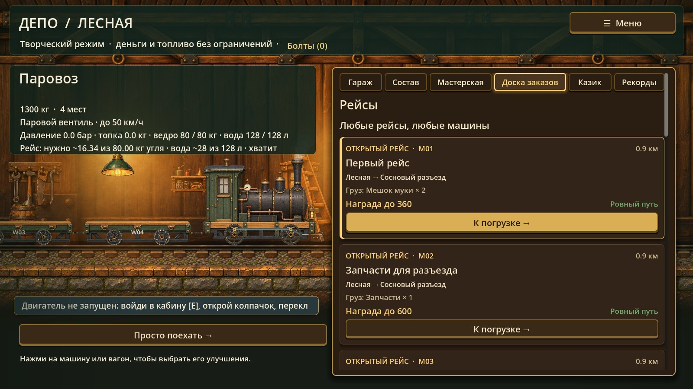
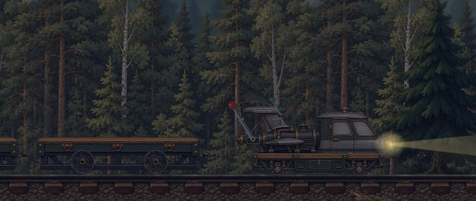

# Лесная колея

Игра для Windows про лесную узкоколейку начала XX века. Первый груз ты везёшь на ручной дрезине. Берёшься мышью за рычаг, раскачиваешь его и следишь, хватит ли разгона до станции. За доставку платят монетами. В депо на них можно починить состав или купить следующую машину.

**[Скачать игру для Windows x64](https://github.com/CPUadmin/ForestRail/releases)**

Открой нужный выпуск и разверни **Assets**. Если скачал ZIP для Windows, распакуй его целиком и запусти `ForestRail.exe`. Если в выпуске приложен сам `ForestRail.exe`, запускай его напрямую.

## Машины и рейсы

На линии девять машин. У ручной дрезины качаешь рычаг, у парусной ловишь ветер, у паровоза разводишь огонь. Позже можно попробовать бензиновую и шестовую дрезины, электровоз, пневмовоз, цеппелин и реактивный поезд.

В кампании заказы оплачивают ремонт и новые машины. В творческом режиме можно сразу попробовать разные составы. В пути доступны вид сбоку и кабина.

## Запуск из исходников

Рабочая ветка — [`uzlovaya`](https://github.com/CPUadmin/ForestRail/tree/uzlovaya). В Godot **4.7.2** импортируй из неё `ForestRail/project.godot` и нажми **F5**.

[История версий](docs/CHANGELOG_RU.md) · [План разработки](docs/PLAN_RAZRABOTKI_RU.md) · [Документация](docs/README_RU.md) · [Проверки и сборка](README_RU.md) · [Правила проекта](CLAUDE.md)
