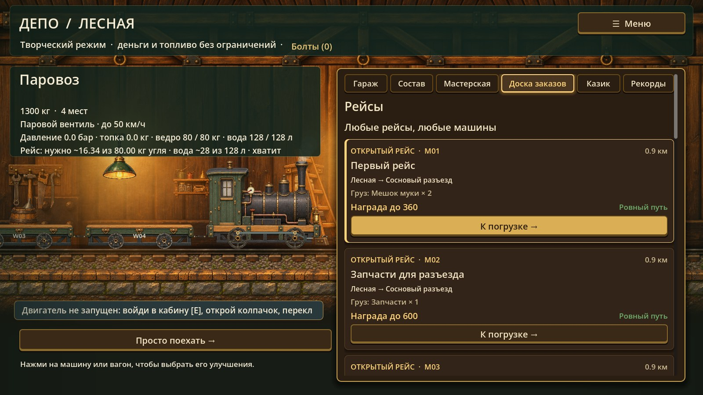
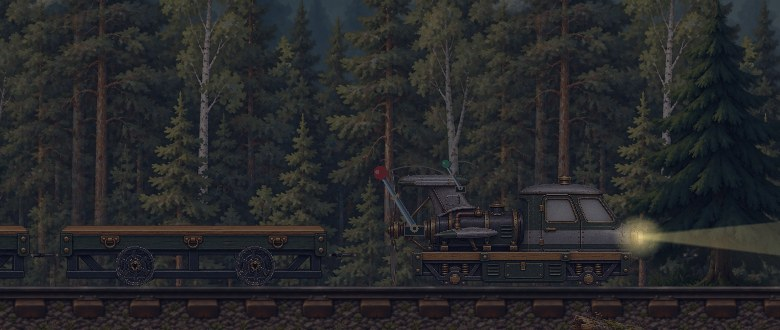

# Лесная колея (Forest Rail)

Уютная игра для Windows про узкоколейку в северном лесу начала XX века. Возишь грузы между станциями, прокачиваешь машины в депо и пробуешь удачу в казике у Михалыча. Сделана на Godot 4.7.2.

**Что в игре (версия 1.2):** 9 машин со своим управлением (ручная и шестовая дрезины, парусная, паровоз, бензиновая, пневматическая, электровоз, цеппелин и реактивный), 18 гаджетов, вид сбоку и вид из кабины, погода, день и ночь, износ и ремонт, карьера и творческий режим.

## Скачать

Готовые сборки лежат в [релизах](https://github.com/CPUadmin/ForestRail/releases). Распакуй и запусти `ForestRail.exe`, установка не нужна.

## Для разработки

- Правила проекта: [CLAUDE.md](CLAUDE.md) и [docs/RULES_RU.md](docs/RULES_RU.md).
- План: [docs/PLAN_RAZRABOTKI_RU.md](docs/PLAN_RAZRABOTKI_RU.md), простыми словами: [docs/PLAN_PROSTO_RU.md](docs/PLAN_PROSTO_RU.md).
- Что читать в документах: [docs/README_RU.md](docs/README_RU.md).
- Как работать на этом компьютере: [README_RU.md](README_RU.md).

*A cozy narrow-gauge forest railway game for Windows (Godot 4.7.2). The project is written in Russian.*
