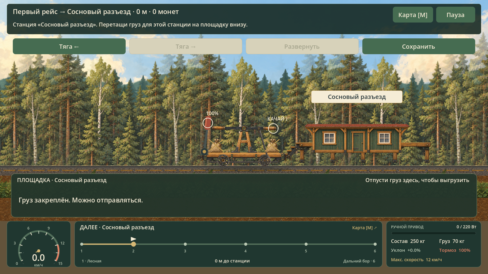
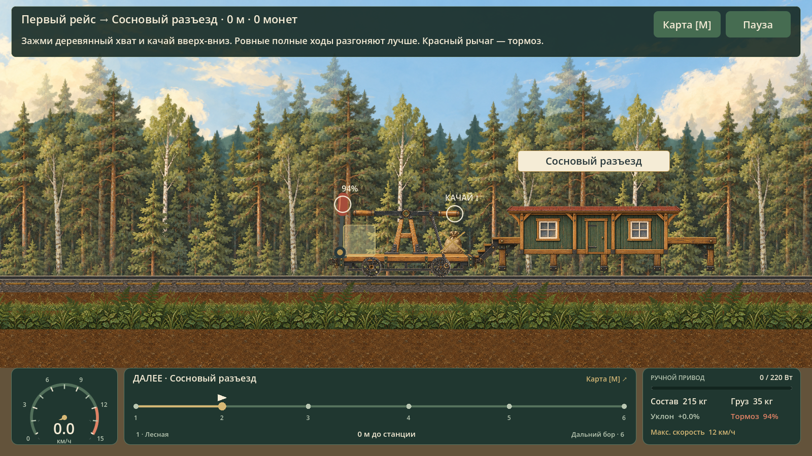

# Аудит «Лесной колеи» перед ТЗ 3.0

Дата: 28.10.2026. Исходники: commit `b08bd48`, игровая версия 1.1.0.
Движок проверки: Godot 4.7.2 stable, Compatibility.
Цель: проверить жалобы на разгрузку, масштаб и работу рычага, затем задать требования разработчику.

## Что проверено

- Исходники model.gd, main.gd, art_v3.gd, art_world.gd, route.gd и существующие проверки.
- Запуск настоящей сцены main.tscn в Godot с отдельным каталогом сохранений и отдельным путём настроек.
- Перенос двух мешков на станции B через Input.parse_input_event: на мировую платформу и в нижнюю панель.
- Поведение стоящего состава с тормозом 94%.
- Скриншоты при zoom 0.75, 1.0 и 1.5.
- Численные пробы наката, смены направления качания и влияния груза.
- Существующие наборы check_model и check_physics.

Проверка намеренно ставит тестовый состав на станцию, чтобы изолировать разгрузку. Это не прохождение всего маршрута человеком и не полная приёмка экспортированного EXE. Вход для переноса проходит через диспетчер событий движка; начальная расстановка груза и позиционирование — подготовка теста.

## Результаты

| Проверка | Фактический результат |
|---|---|
| Существующий check_model | 9103 проверки, 0 ошибок |
| Существующий check_physics | 57 проверок, 0 ошибок |
| Захват мешка мышью | Успешный |
| Отпускание на видимую платформу станции | delivered=false, груз остаётся на handcar:0, сообщения нет |
| Отпускание в нижнюю панель | delivered=true, место освобождается |
| Второй мешок через панель | Доставлен; deliveries=2, active.phase=return |
| Выплата после разгрузки | 100 монет отложено; деньги пока 0 — соответствует текущим правилам |
| Стоянка, brake=0.94 | dock_visible=false; transfer=false |
| Смена знака движения в середине хода | Кривошип меняет фазу примерно на −176.75° при прежнем угле рычага |
| Накат 2 секунды, начальная скорость 2 м/с | Путь 3.8704 м; колесо около 1056°; рычаг и кривошип не поворачиваются |
| Одинаковый ввод, масса 180/300 кг | Скорости 1.486/1.090 м/с; разница углов рычага 0° |
| Заголовок свободного рейса к F | «Свободный рейс · Дальний бор → Дальний бор» |

Вывод по разгрузке: операция доставки в модели работает. Проблема проявляется в выборе цели и обратной связи: видимая платформа не принимает предмет, панель принимает, но сама выдаёт противоречивое сообщение и скрывается при недостающем тормозе.

Вывод по физике: масса уже влияет на движение состава, тормоз и базовая инерция реализованы. Однако ручной привод не является единым механическим приводом от руки до колёс. Старые тесты закрепляют часть упрощённого поведения и не проверяют найденные скачки и несогласованность.

## Где находятся причины

Номера строк относятся к проверенному commit и могут сдвинуться.

| Файл / место | Причина |
|---|---|
| scripts/main.gd, finish_drag, около 861 | Целями являются слоты и dock_rect; физическая платформа не участвует. invalid завершается без объяснения |
| scripts/main.gd, dock_visible, около 886 | Панель скрывается, пока model.stopped() ложен |
| scripts/model.gd, stopped, около 139 | Для стоянки требуется abs(v)<0.1 и brake>=0.95 |
| scripts/main.gd, draw_loading_dock, около 1193 | index считает только предметы домашней площадки; на B получается 0 и выбирается текст «Можно отправляться» |
| scripts/main.gd, update_hud, около 573 | Полезная текущая подсказка скрывается вместе с tutorial |
| scripts/art_world.gd, draw_stations, 110–123 | Постоянный множитель 0.72 и экранные отступы вместо общего мирового масштаба |
| scripts/art_v3.gd, PX / manifest | Транспорт имеет физическую ширину; здание с шириной 5 м и пропорциями исходного PNG слишком низкое |
| scripts/main.gd, lever_geometry, около 1125 | Крупные жёстко заданные координаты рычагов и высокая стойка старта |
| scripts/main.gd, draw_train, около 1056 | Соединение кузовов нарисовано линией, без локальных сцепных точек |
| scripts/model.gd, body_s, около 125 | Расстояния между центрами заданы 3.8/3.5 м независимо от реальных габаритов |
| scripts/model.gd, physics_step, около 551 | Угол задаётся вводом, работа — модулем углового перемещения; нагрузка не участвует в решении угла |
| scripts/art_v3.gd, pose, около 89 | Из двух решений кривошипа выбирается ветвь по знаку движения |
| scripts/art_v3.gd, draw_vehicle, около 120 | Колёса вращаются по расстоянию отдельно от фазы механизма |
| scripts/model.gd, free_offers + main.gd, update_hud | Пункт назначения уже есть в title, затем повторно добавляется через стрелку |

## Размеры при разных масштабах камеры

| Zoom | Ширина дрезины, px | Ширина домика, px | Высота домика, px | Домик / дрезина по ширине |
|---|---:|---:|---:|---:|
| 0.75 | 230.4 | 345.6 | 95.97 | 1.50 |
| 1.00 | 307.2 | 345.6 | 95.97 | 1.125 |
| 1.50 | 460.8 | 345.6 | 95.97 | 0.75 |

Приближение увеличивает дрезину относительно здания вдвое между крайними значениями zoom. Даже при zoom=1 фактическая высота домика соответствует примерно одному метру при базовых 96 px/м.

Та же ветка draw_stations применяется к депо, домику, навесу лесопилки и платформе. Для всех них нужно исправить преобразование, затем отдельно подобрать физические размеры по дверям, воротам и высоте настила.

Рычаги моторной дрезины в проверенной геометрии:
- тормоз: 0.990 м;
- переключатель передачи: 0.865 м;
- газ: 0.792 м;
- ось тумблера запуска: высота 1.917 м над рельсом.

Это объясняет вид высоких рычагов на пользовательском скриншоте. Большая область нажатия может остаться, но сам рисунок должен иметь компактный размер.

## Скриншоты из игры

### Прибытие до разгрузки

### Сброс на видимую платформу

### Работающий сброс в нижнюю панель

### Неподвижная машина с тормозом 94%

### Камера 1.5

Пользовательские исходные кадры: [крупный план](../outputs/ForestRail_DevSpec_v3/evidence/user_controls.png), [весь экран](../outputs/ForestRail_DevSpec_v3/evidence/user_fullscreen.png).

## Файлы для воспроизведения

- [audit_results.json](../outputs/ForestRail_DevSpec_v3/evidence/audit_results.json) — численные результаты.
- [runtime.log](../outputs/ForestRail_DevSpec_v3/evidence/runtime.log) — вывод запуска Godot.
- [check_model.log](../outputs/ForestRail_DevSpec_v3/evidence/check_model.log), [check_physics.log](../outputs/ForestRail_DevSpec_v3/evidence/check_physics.log) — исходные проверки.
- [audit.gd](../outputs/ForestRail_DevSpec_v3/evidence/audit.gd) — сценарий UI и физических проб.
- [run_audit.py](../outputs/ForestRail_DevSpec_v3/evidence/run_audit.py) — запуск на машине автора; пути к Godot и проекту нужно адаптировать на другом компьютере.
- В рабочем проекте исходные проверочные файлы находятся в work/audit_v3. Это диагностический стенд, а не код исправлений.

Первый запуск обёртки завершился ошибкой вывода Unicode-стрелки в консоль Windows уже после успешной работы Godot и записи отчёта. Вывод обёртки исправлен, запуск повторён. Игровые результаты сохранены независимо от печати в консоль.

## Что ещё не проверено

- Прохождение всех рейсов человеком и экспортированной сборкой после будущих исправлений.
- Перетаскивание каждого типа груза на каждом вагоне при всех разрешениях.
- Новая модель физики: в этом этапе она только спроектирована.
- Новые габариты и новые интерфейсы в игре: пока это требования.
- Субъективное удобство управления: требует ручной пробы после P1/P4.

Не переносить статус «проверки проходят» на эти пункты.

