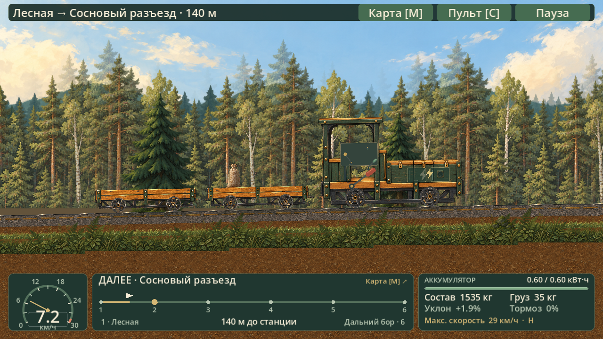

# Лесная колея

Игра для Windows о лесной железной дороге: начни с ручной дрезины, доставляй грузы и открой бензиновую дрезину, аккумуляторный локомотив и грузовые вагоны. Сделана на Godot 4.7.2; исходная версия — по ТЗ 2.1, текущее обновление — по [ТЗ 3.0](TECH_SPEC_RU.md).

В ветке `codex/spec-v3-p8` собрана проверочная версия 1.2.0-preview.8: связанный ручной привод с маховиком, выбор количества груза, моторный пульт, переработанный интерфейс и шесть оформленных остановок. Автоматическая часть P8 проверена; проба первого рейса человеком остаётся открытой. Подробности — в [журнале разработки](DEVELOPMENT_LOG_v3.md) и [приёмке P8](P8_ACCEPTANCE_RU.md).

[Посмотреть карту всей линии](../screenshots/map_1.1.0.png).

## Скачать и играть

Локальная проверочная поставка: `qa/v3_p8/ForestRail_P8_preview.zip`, запуск через `Play_P8.cmd`; её прогресс хранится отдельно в папке `profile`. Архив исходников и Git bundle находятся рядом. На рабочем компьютере основной ярлык использует установленную проверочную версию с отдельным профилем. Редактор для игры не нужен.

Опубликованные исторические версии доступны в [релизах](https://github.com/CPUadmin/ForestRail/releases); последний внешний релиз — 1.1.0. Проверочная 1.2.0 пока поставляется локально.

Ручная дрезина управляется мышью: отпусти красный тормоз и качай правый деревянный хват. Груз влияет на разгон, торможение и движение на уклонах. Моторная дрезина расходует бензин; электролокомотив — заряд аккумулятора с рекуперацией при торможении. В депо можно менять состав, заправляться и покупать улучшения конкретных машин и вагонов.

В версии 1.1.0 есть спидометр со шкалой под машину и улучшения, миникарта, показатели массы, энергии, уклона и тормоза. Кнопка «Карта» или M открывают карту всей линии. Подробное управление — в [инструкции](../../README_RU.md).

## Все версии

История ТЗ 3.0 хранится отдельными ветками: `dev/spec-v3-p1`, `dev/spec-v3-p2`, `codex/spec-v3-p3` … `codex/spec-v3-p8`. В них находятся исходники, исходные ассеты и отчёты соответствующих этапов. Основная ветка опубликованной 1.1.0 сохранена.

В каждом релизе сохранены исходный архив Windows, архив исходников именно этой версии и контрольные суммы SHA-256. Архивы предыдущих версий не пересобирались.

| Версия | Что изменилось | Релиз | Исходники в Git |
|---|---|---|---|
| 1.1.0 | Приборы, миникарта, большая карта и выбор станции | [Скачать](https://github.com/CPUadmin/ForestRail/releases/tag/v1.1.0) | [v1.1.0](https://github.com/CPUadmin/ForestRail/tree/v1.1.0) |
| 1.0.2 | Полный набор новой графики, механизм по шарнирам, лес и станции | [Скачать](https://github.com/CPUadmin/ForestRail/releases/tag/v1.0.2) | [v1.0.2](https://github.com/CPUadmin/ForestRail/tree/v1.0.2) |
| 1.0.1 | Задний ход с грузом, исправленные колёса и ручной привод | [Скачать](https://github.com/CPUadmin/ForestRail/releases/tag/v1.0.1) | [v1.0.1](https://github.com/CPUadmin/ForestRail/tree/v1.0.1) |
| 1.0.0 | Полная карьера, три машины, вагоны, депо и сохранения | [Скачать](https://github.com/CPUadmin/ForestRail/releases/tag/v1.0.0) | [v1.0.0](https://github.com/CPUadmin/ForestRail/tree/v1.0.0) |

В релиз 1.1.0 также входит `ForestRail_AllHistory.bundle` — автономная копия всей Git-истории, веток и тегов на момент публикации. Её можно восстановить командой `git clone ForestRail_AllHistory.bundle ForestRail`.

## Открыть исходники

1. Клонируй репозиторий или скачай `Source.zip` нужного релиза.
2. Импортируй `ForestRail/project.godot` в Godot 4.7.2 и запусти главную сцену.
3. Для самостоятельной Windows-сборки подготовь официальный шаблон экспорта: `python tools/fetch_windows_template.py`. Скрипт сохраняет его в `tools/templates/`.
4. Выполни `godot --headless --path ForestRail --export-release "Windows Desktop" ../release/ForestRail/ForestRail.exe`.

Для проверки проекта: `python tools/run_checks.py <путь-к-Godot> --suite check_model,check_physics,check_interaction,check_handcar_revision,check_art_v3,check_instruments,check_presentation,drive_campaign`. Графические проверки требуют обычного оконного сеанса Windows. Запуск занимает несколько минут.

## Состав репозитория

- `ForestRail/` — игровой проект, код, задания, ассеты и проверки.
- `docs/` — ТЗ, сверка реализации, описание обновлений и происхождение материалов.
- `tools/` — подготовка шаблона, проверка, упаковка, установка и публикация.
- `work/art_v3/` — сохранённые вспомогательные скрипты подготовки графики и проверки её геометрии.
- `qa/` — отчёты проверок; снимки игрового процесса находятся в `docs/screenshots/`.

Сохранения игрока находятся в `%APPDATA%\ForestRail\`. Для запуска новой версии их переносить не нужно.

Код, картинки и история проекта сохранены вместе. Происхождение ассетов и лицензии сторонних компонентов описаны в [MATERIALS_RU.md](../MATERIALS_RU.md); уведомления Godot включены в документацию.
