# Визуальные варианты «Лесной колеи»

13 изображений, созданных встроенным image_gen. PNG сохранены без редактирования. Размеры — 1672×940 или 1672×941 px.

Это иллюстрации локаций и макеты экранов. Кнопки, текст и объекты сведены в одну картинку; отдельных анимационных деталей, альфа-слоёв и проверенных точек вращения в этих изображениях нет. ТЗ 3.0 имеет приоритет над нарисованными размерами, схемами механизма и числами интерфейса.

## 1. Главное меню

Меню с лесом и домашним депо. Ориентир света и материалов.

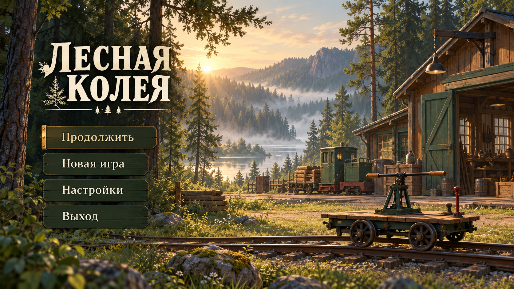

## 2. Депо «Лесная» — сборка

Мастерская с выбранной дрезиной и отдельными ветками её улучшений.

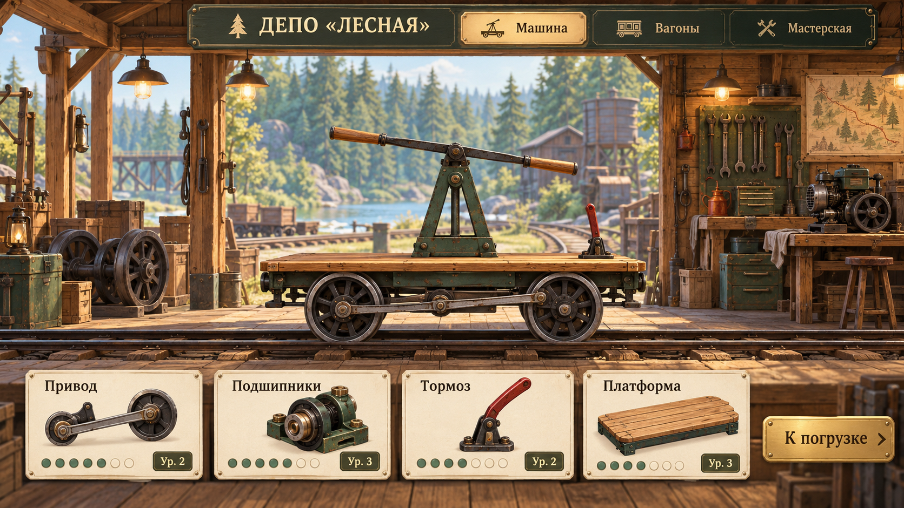

## 3. Выбор загрузки

Выбор загрузки: свободные места, масса и ожидаемая оплата. Числа иллюстративные.

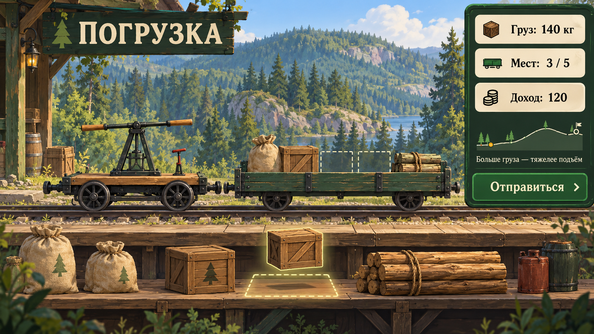

## 4. Сосновый разъезд

Первая небольшая станция: домик, сосны, короткая площадка.

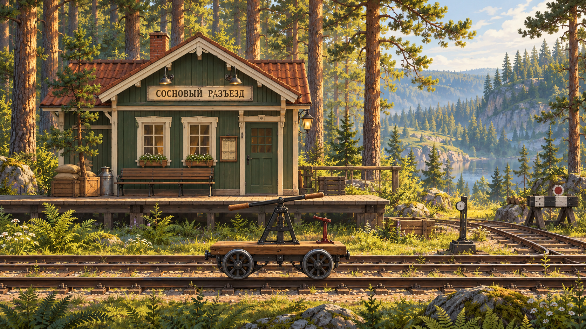

## 5. Лесопилка

Тяжёлые грузы, брёвна, навес и погрузочное оборудование.

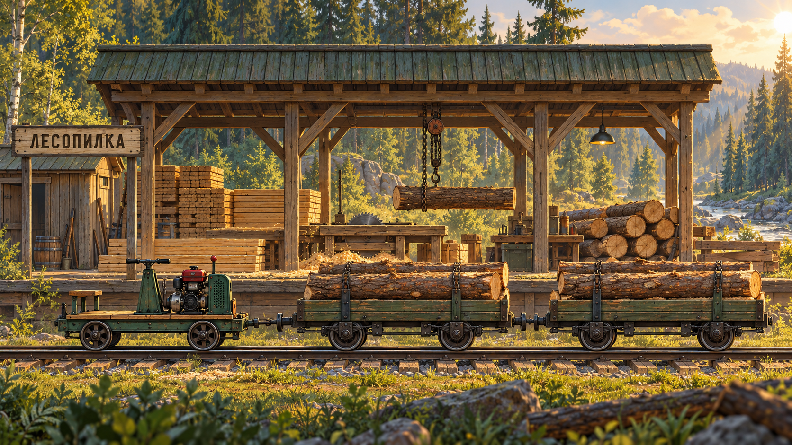

## 6. Тихая заводь

Водная низина, берёзы, причал и лёгкий туман.

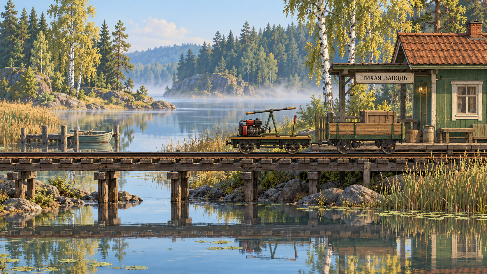

## 7. Верхний бор

Остановка после подъёма, скалы и обзор долины.

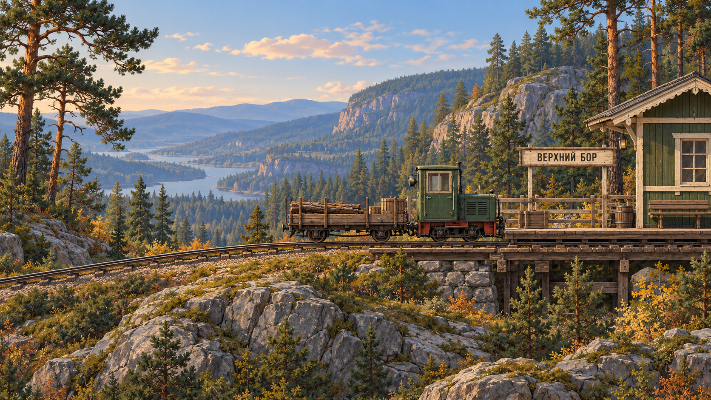

## 8. Дальний бор

Дальняя станция и длинный состав, вечерний свет.

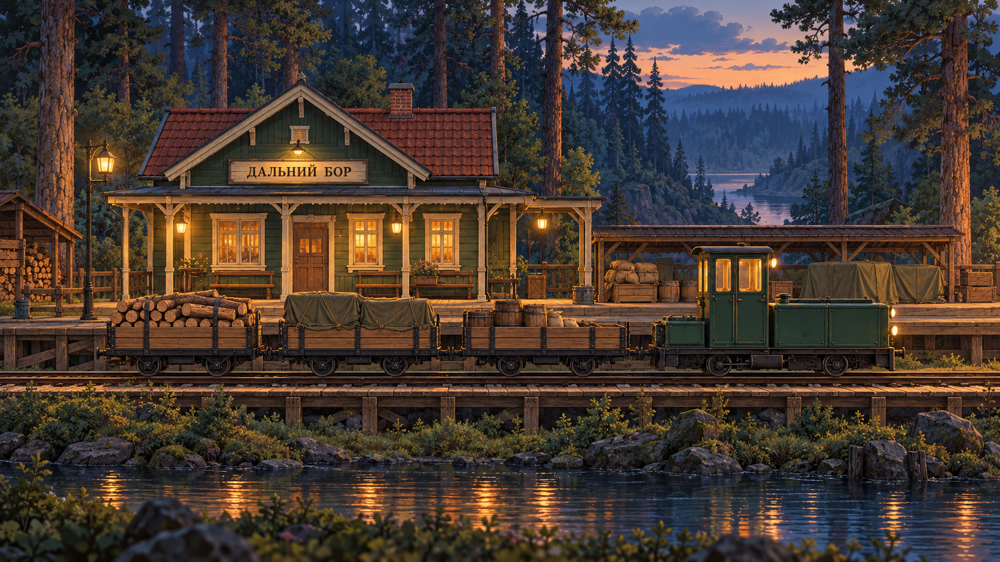

## 9. Поездка через лес

Боковой вид во время поездки, компактные приборы и карта.

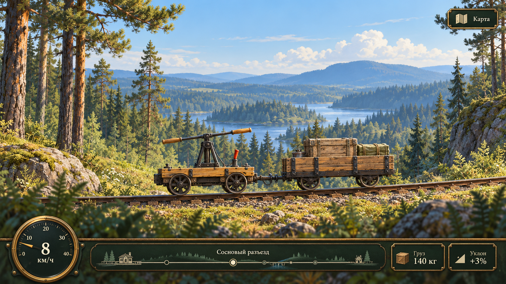

## 10. Ночная стоянка

Возможное последующее обновление: ночная стоянка и тёплые фонари.

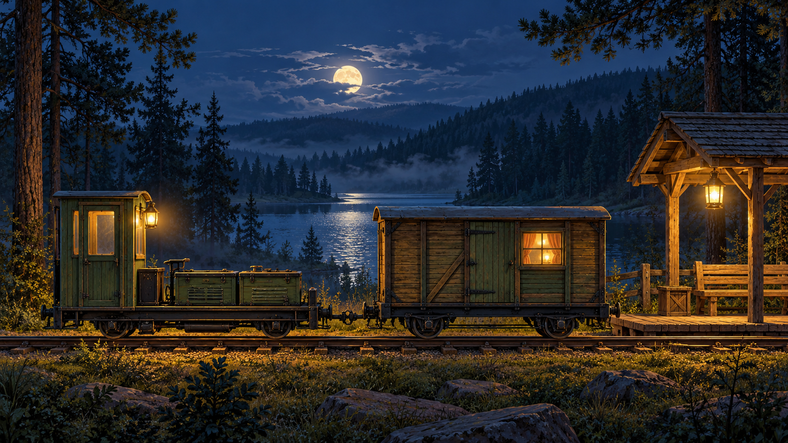

## 11. Карта линии

Названия и порядок шести станций. Нарисованные высоты не задают генератор.

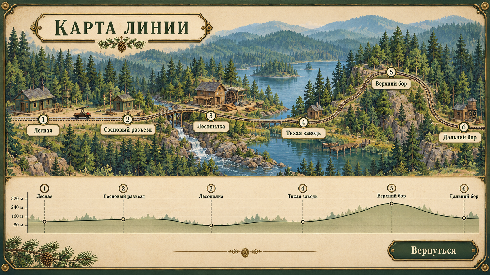

## 12. Улучшение конкретного вагона

Выбранный вагон W02 и его собственные улучшения.

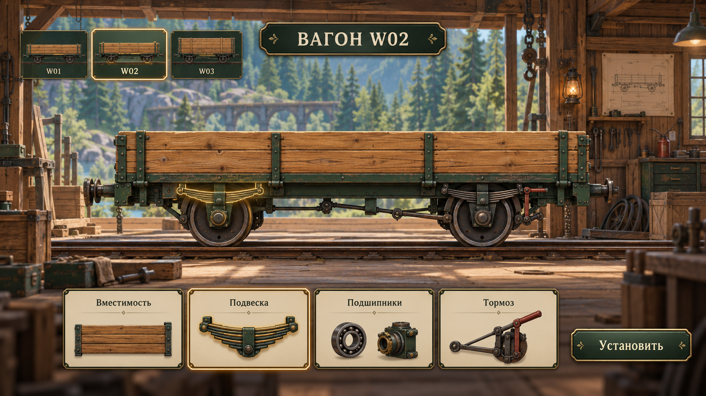

## 13. Промежуточная техника

Шесть вариантов машины рядом; перечень ниже.

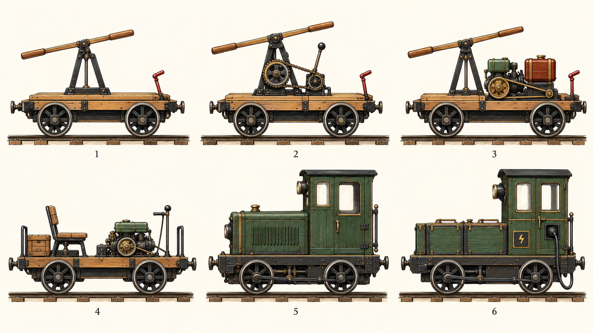

## Техника на последнем листе

1. Ручная дрезина.
2. Грузовая ручная дрезина с двумя передачами.
3. Ручная дрезина с навесным мотором.
4. Открытая моторная дрезина.
5. Малый бензиновый тягач.
6. Аккумуляторный локомотив.

Лёгкая аккумуляторная и педальная дрезины описаны как дополнительные варианты в [VEHICLES_AND_UPDATES_RU.md](VEHICLES_AND_UPDATES_RU.md); отдельных рисунков для них в серии нет.

## Запросы генерации

Полные запросы: [IMAGE_PROMPTS_RU.md](IMAGE_PROMPTS_RU.md). Общая палитра: тёплое дерево, тёмная сталь, зелёная краска, латунь, хвойный лес. Ракурс техники преимущественно боковой. При переносе в игру использовать метрический стандарт и проверяемую геометрию из ТЗ.

